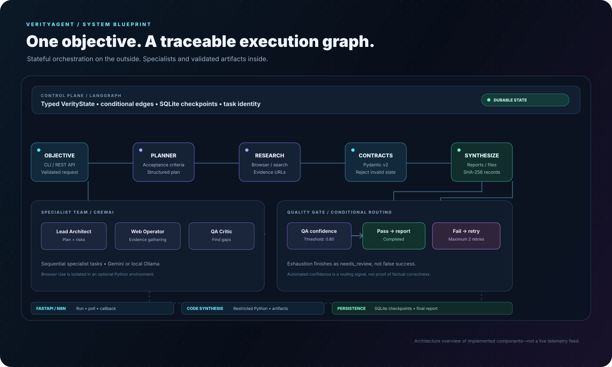
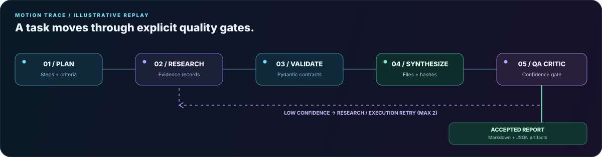
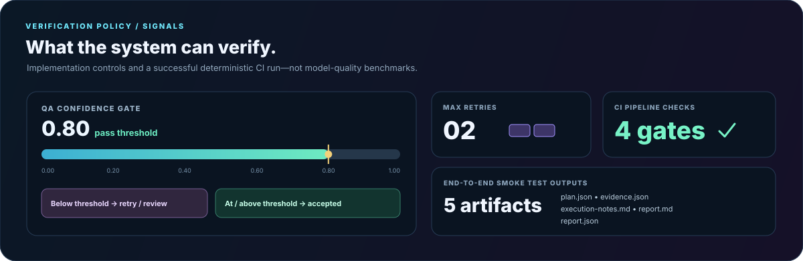

<div align="center">



<p>
<a href="https://github.com/muhammadsaeed-ai/verity-core-agent/actions"></a>


</p>

### A hybrid autonomous workflow engine by VerityAgent

**Plan → Research → Validate → Synthesize → Critique → Route**

[Interactive Showcase source](https://github.com/muhammadsaeed-ai/verity-core-agent/blob/main/docs/index.html) · [Source Code](https://github.com/muhammadsaeed-ai/verity-core-agent) · [CI Runs](https://github.com/muhammadsaeed-ai/verity-core-agent/actions) · [API Docs (local)](#api-contract)

</div>

Verity-1 is built around a precise idea: autonomous workflows should not hide state, silently invent evidence, or treat every run as a success. It combines **LangGraph** state control and SQLite checkpoints, **CrewAI** specialist roles, **Pydantic v2** contracts, browser/search tools, artifact synthesis, and **FastAPI** orchestration.

> **Design principle:** make execution traceable, make uncertainty visible, and keep finalization behind a quality gate. The project does not automatically execute arbitrary model-generated Python as part of its normal workflow.

## The system, visualized

<div align="center">

</div>

The outer graph owns state transitions and retry decisions. Specialist agents contribute analysis, browser results are stored as explicit records, data crosses schema boundaries, and the QA critic decides whether the workflow can finish or must retry.

<details>
<summary><strong>▶ Play the animated workflow replay</strong></summary>
<div align="center"></div>
This is an illustrative motion diagram of the implemented control flow, not a recording of a live task or a live telemetry feed. The interactive showcase source is [docs/index.html](https://github.com/muhammadsaeed-ai/verity-core-agent/blob/main/docs/index.html). To host it as a live site, open repository **Settings → Pages**, choose **GitHub Actions** as the source, then run **Deploy Verity-1 showcase** from the Actions tab. GitHub denied automatic Pages-site creation for this connection because it does not have the required repository-settings permission.
</details>

## Verification, not vanity metrics

<div align="center"></div>

These figures describe the current implementation and verified deterministic CI baseline. They are **not** claims about answer accuracy, latency, browser coverage, or production uptime.

| Control | Current behavior |
|---|---|
| QA acceptance threshold | <code>confidence &gt;= 0.80</code> |
| Retry budget | Maximum 2 retries; failed exhaustion ends as <code>needs_review</code> |
| Automated verification | Dependency consistency, unit/integration tests, production Docker image build, and deterministic E2E smoke test |
| End-to-end outputs | <code>plan.json</code>, <code>evidence.json</code>, <code>execution-notes.md</code>, <code>report.md</code>, <code>report.json</code> |
| Persistence | SQLite-backed LangGraph checkpointing plus task records |
| Hand-off validation | Pydantic v2 models with unexpected fields forbidden |

## Capability map

<table>
<tr><td width="50%" valign="top">

### Stateful control plane

- LangGraph StateGraph and conditional routing
- SQLite SqliteSaver checkpointing
- Task IDs mapped to graph thread IDs
- Bounded retries with explicit terminal status

</td><td width="50%" valign="top">

### Specialist execution

- **Lead Architect & Planner**
- **Deep Web Intelligence Operator**
- **QA Verifier & Critic**
- CrewAI sequential specialist tasks

</td></tr>
<tr><td width="50%" valign="top">

### Evidence and synthesis

- Browser Use in a separate optional environment
- Playwright with DuckDuckGo HTML HTTP fallback
- Pydantic validation for structured evidence
- Markdown / JSON artifacts and SHA-256 metadata

</td><td width="50%" valign="top">

### API and automation

- FastAPI task-run and status endpoints
- Interactive local OpenAPI docs
- Operator-configured n8n completion/failure callback
- Docker and Docker Compose support

</td></tr>
</table>

## Quick start

**Baseline:** Python 3.12. The deterministic smoke test runs without an external model key or browser session.

<pre><code>git clone https://github.com/muhammadsaeed-ai/verity-core-agent.git
cd verity-core-agent

python -m venv .venv
# Windows PowerShell:
.venv\Scripts\Activate.ps1
# macOS / Linux:
# source .venv/bin/activate

python -m pip install --upgrade pip
pip install -r requirements.txt</code></pre>

Copy <code>.env.example</code> to <code>.env</code>, then run the verified deterministic path:

<pre><code>python main.py --test-e2e</code></pre>

Expected files are written under <code>outputs/&lt;task-id&gt;/</code>. The smoke test exits non-zero if a required artifact is missing or QA does not finish as accepted.

### Run a live task

Configure <code>GOOGLE_API_KEY</code> in <code>.env</code> for Gemini, or use Ollama as described below:

<pre><code>python main.py --task "Research current Python agent orchestration options and produce a sourced comparison"</code></pre>

A configured model is required. Live research also needs internet access. When search backends return no usable sources, Verity-1 reports that limitation rather than fabricating source URLs.

### Start the API

Before starting it, generate a unique secret:

<pre><code>python -c "import secrets; print(secrets.token_urlsafe(32))"</code></pre>

Copy the generated value into <code>VERITY_API_KEY=...</code> in <code>.env</code>. The run/status endpoints deliberately fail closed until this value is configured; <code>/health</code> remains public.

<pre><code>python main.py --serve</code></pre>

Open <code>http://127.0.0.1:8000/docs</code>. Supply the <code>X-API-Key</code> header when calling protected endpoints.

<pre><code>curl -X POST http://127.0.0.1:8000/api/v1/agent/run \
  -H "Content-Type: application/json" \
  -H "X-API-Key: YOUR_VERITY_API_KEY" \
  -d '{"user_objective":"Create a verifiable report for a test workflow objective."}'</code></pre>

Use the same header to query <code>GET /api/v1/agent/status/{task_id}</code>. Keep the key private and never commit <code>.env</code>.

## Model providers

### Gemini — default

<pre><code>VERITY_PROVIDER=gemini
GOOGLE_API_KEY=your_google_ai_studio_key
VERITY_GEMINI_MODEL=gemini-2.5-flash</code></pre>

Availability, quotas, rate limits, and data handling depend on Google's current terms. Unlimited free inference is not guaranteed.

### Ollama — local inference

Install Ollama separately and retrieve a model:

<pre><code>ollama pull llama3.2</code></pre>

Then configure:

<pre><code>VERITY_PROVIDER=ollama
VERITY_OLLAMA_MODEL=llama3.2
VERITY_OLLAMA_BASE_URL=http://localhost:11434
VERITY_RESEARCH_ENABLED=false
N8N_WEBHOOK_URL=</code></pre>

This can keep model inference local and disables online research/callbacks. Installing packages and downloading model weights require network access beforehand.

## Browser Use dependency isolation

Recent Browser Use releases and the selected CrewAI release declare incompatible major versions of MCP. To avoid an unsatisfiable installation in the main environment, Browser Use is optional and installed into a separate Python environment:

<pre><code>python -m venv .venv-browser-use</code></pre>

Install <code>requirements-browser-use.txt</code> in that environment, then set <code>VERITY_BROWSER_ENGINE=browser-use</code>. The tool auto-detects <code>.venv-browser-use</code>, or you can specify <code>VERITY_BROWSER_USE_PYTHON</code>. Browser Use remains blocked unless <code>VERITY_BROWSER_USE_NETWORK_ISOLATED=true</code>; set that only after enforcing operating-system/container outbound network restrictions that prevent access to localhost, private subnets, link-local/cloud metadata, and other internal endpoints. A configuration flag alone is not a network security boundary. Playwright and the HTTP fallback remain available from the main environment.

For Playwright, install the browser binary once:

<pre><code>python -m playwright install chromium</code></pre>

## API contract

| Method | Endpoint | Purpose |
|---|---|---|
| <code>POST</code> | <code>/api/v1/agent/run</code> | Accept a task; optional <code>Idempotency-Key</code> prevents duplicate submissions |
| <code>GET</code> | <code>/api/v1/agent/status/{task_id}</code> | Read task status, QA feedback and artifacts |
| <code>GET</code> | <code>/api/v1/agent/tasks</code> | Filtered, paginated task inventory |
| <code>GET</code> | <code>/api/v1/agent/status/{task_id}/events</code> | Ordered audit timeline with incremental cursor |
| <code>GET</code> | <code>/api/v1/agent/status/{task_id}/artifacts/verify</code> | Verify generated artifact SHA-256 checksums and sizes |
| <code>GET</code> | <code>/health</code> | Service liveness check |

The request accepts <code>user_objective</code> or the alias <code>objective</code>, plus an optional <code>task_id</code>. IDs may contain letters, numbers, underscores, and hyphens. Duplicate IDs return <code>409</code>; unknown tasks return <code>404</code>. Admission is bounded by <code>VERITY_MAX_ACTIVE_TASKS</code> (default <code>4</code> per server process); excess requests receive <code>429</code> with a <code>Retry-After</code> header. Optionally send an <code>Idempotency-Key</code> (8–128 letters, digits, dot, underscore, colon, or hyphen) to make retries safe: the same key and objective return the original task; reusing that key with a different objective returns <code>409</code>.

For retry-safe client submissions, send a stable <code>Idempotency-Key</code> header (8–128 letters, digits, dots, underscores, colons, or hyphens). A repeated key with the same objective returns the original task without queueing a second execution. Reusing the key with a different objective returns <code>409</code>. Keys and task creation are recorded atomically in SQLite to handle concurrent retries. Example:

```bash
curl -X POST http://127.0.0.1:8000/api/v1/agent/run \
  -H "Content-Type: application/json" \
  -H "X-API-Key: YOUR_VERITY_API_KEY" \
  -H "Idempotency-Key: invoice-audit-2026-001" \
  -d '{"objective":"Produce an auditable report for this invoice workflow."}'
```

Idempotency prevents duplicate accepted submissions; it does not turn FastAPI background tasks into a durable queue. A process restart can still interrupt work accepted just before it starts.

Verify generated artifacts without downloading their contents:

```bash
curl -H "X-API-Key: YOUR_VERITY_API_KEY" \
  "http://127.0.0.1:8000/api/v1/agent/status/YOUR_TASK_ID/artifacts/verify"
```

The integrity endpoint checks each recorded file's SHA-256 digest and byte count. It returns per-artifact states such as <code>verified</code>, <code>mismatch</code>, <code>missing</code>, <code>invalid_path</code>, and <code>rejected_symlink</code>. It restricts records to files directly inside that task's output directory, rejects path traversal and symlinks, and never returns artifact contents. This proves consistency with the stored manifest—not the truth or safety of the underlying artifact.

Configure <code>N8N_WEBHOOK_URL</code> only for an endpoint you control. Callback URLs are operator configuration, not accepted from public run requests.

## Configuration

| Variable | Default | Meaning |
|---|---|---|
| <code>VERITY_PROVIDER</code> | <code>gemini</code> | <code>gemini</code> or <code>ollama</code> |
| <code>VERITY_GEMINI_MODEL</code> | <code>gemini-2.5-flash</code> | Gemini model |
| <code>VERITY_OLLAMA_MODEL</code> | <code>llama3.2</code> | Local Ollama model |
| <code>DRY_RUN_TEST_MODE</code> | <code>false</code> | Deterministic evidence and QA for tests |
| <code>VERITY_RESEARCH_ENABLED</code> | <code>true</code> | Enable web research |
| <code>VERITY_BROWSER_ENGINE</code> | <code>playwright</code> | <code>playwright</code> or <code>browser-use</code> first |
| <code>VERITY_BROWSER_USE_PYTHON</code> | auto-detect | Optional isolated Browser Use interpreter |
| <code>VERITY_ENABLE_CREWAI</code> | <code>true</code> | Enable live specialist crew |
| <code>VERITY_DATABASE_PATH</code> | <code>data/verity.sqlite3</code> | SQLite checkpoint/task database |
| <code>VERITY_OUTPUT_DIR</code> | <code>outputs</code> | Artifact output root |
| <code>N8N_WEBHOOK_URL</code> | empty | Trusted completion/failure callback |
| <code>VERITY_API_KEY</code> | empty (protected API disabled) | Required secret for run/status endpoints; send as <code>X-API-Key</code> |
| <code>VERITY_API_HOST</code> | <code>0.0.0.0</code> | API bind host |
| <code>VERITY_API_PORT</code> | <code>8000</code> | API port |
| <code>VERITY_MAX_ACTIVE_TASKS</code> | <code>4</code> | Per-process cap for queued/running requests; excess requests receive <code>429</code> |

## Verification

Run the test suite and end-to-end smoke test:

<pre><code>pytest -v
python main.py --test-e2e</code></pre>

GitHub Actions checks dependency consistency, runs unit/integration tests, builds the production Docker image, and runs the deterministic smoke test on pushes and pull requests. Inspect the [CI run history](https://github.com/muhammadsaeed-ai/verity-core-agent/actions) for the latest result.

## Repository structure

<pre><code>docs/
├── index.html                    # Interactive branded control-room showcase
└── assets/
    ├── verity-hero.svg            # Hero artwork + animated system trace
    ├── architecture-infographic.svg
    ├── quality-policy.svg         # Policy values + current CI baseline
    └── workflow-replay.svg        # Animated workflow motion diagram
src/
├── config.py                      # Gemini / Ollama providers and settings
├── schemas.py                     # Pydantic v2 contracts
├── tools/
│   ├── browser_tool.py            # Browser Use bridge + Playwright + HTTP fallback
│   └── code_sandbox.py            # Restricted Python runner + artifact writer
├── crew/specialist_crew.py        # CrewAI specialist roles
├── graph/
│   ├── state.py                   # Typed state contract
│   └── workflow.py                # Graph nodes, QA routing, SQLite checkpoints
└── api/
    ├── server.py                  # FastAPI + n8n gateway
    ├── observability.py           # Task inventory and audit timeline
    └── integrity.py               # Safe SHA-256 artifact verification
scripts/browser_use_worker.py      # Isolated Browser Use worker
main.py                            # CLI and server runner
tests/                             # Unit, retry, API and workflow tests</code></pre>

## Security and reliability boundaries

- QA confidence is an automated signal, not proof of factual correctness.
- A source URL shows that a result was retrieved; it does not prove every associated claim.
- Browser navigation requires installed browser dependencies; the HTTP parser is the final fallback.
- All task API routes (run, status, inventory, and audit events) require <code>X-API-Key</code>; they return <code>503</code> until <code>VERITY_API_KEY</code> is configured and <code>401</code> for missing or incorrect keys. Keep the key private and use TLS behind a trusted reverse proxy for remote deployment.
- The restricted Python runner uses a separate process, timeout, and best-effort OS resource limits where supported. It is still defense-in-depth, not a secure multi-tenant OS sandbox; do not expose arbitrary submitted code as a service without stronger container/VM isolation.
- URL normalization rejects non-HTTP schemes, credentialed URLs, local/private IPs, intranet hostnames, and unusual ports. These checks reduce unsafe results but do not replace network-egress controls or protection against DNS rebinding in a browser worker.
- The n8n callback is outbound network traffic. Configure a destination you control.
- API task admission is bounded per server process by <code>VERITY_MAX_ACTIVE_TASKS</code> (default <code>4</code>); saturation returns <code>429</code> with <code>Retry-After</code>. FastAPI background tasks are not a durable distributed queue: a process restart can interrupt in-flight work. Use a persistent job queue for workloads that must survive restarts or run across multiple replicas.
- Follow each model provider's current usage terms and data policies.

---

<div align="center">

**Built for developers by VerityAgent.**  
Open-source foundation maintained by Muhammad Saeed, founder and owner of VerityAgent.

</div>
